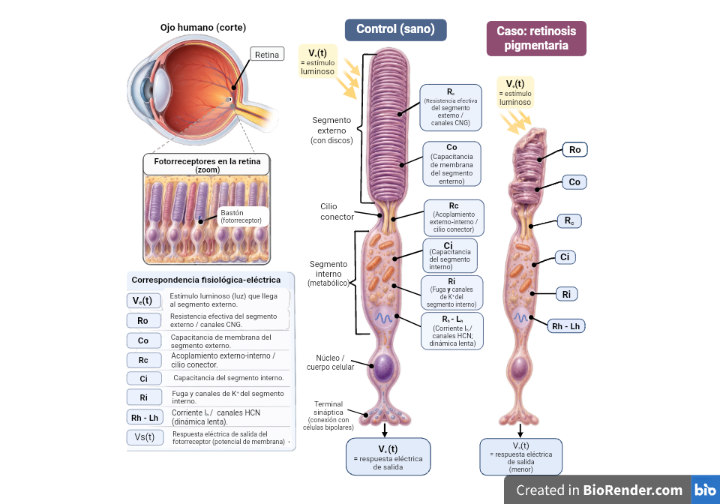
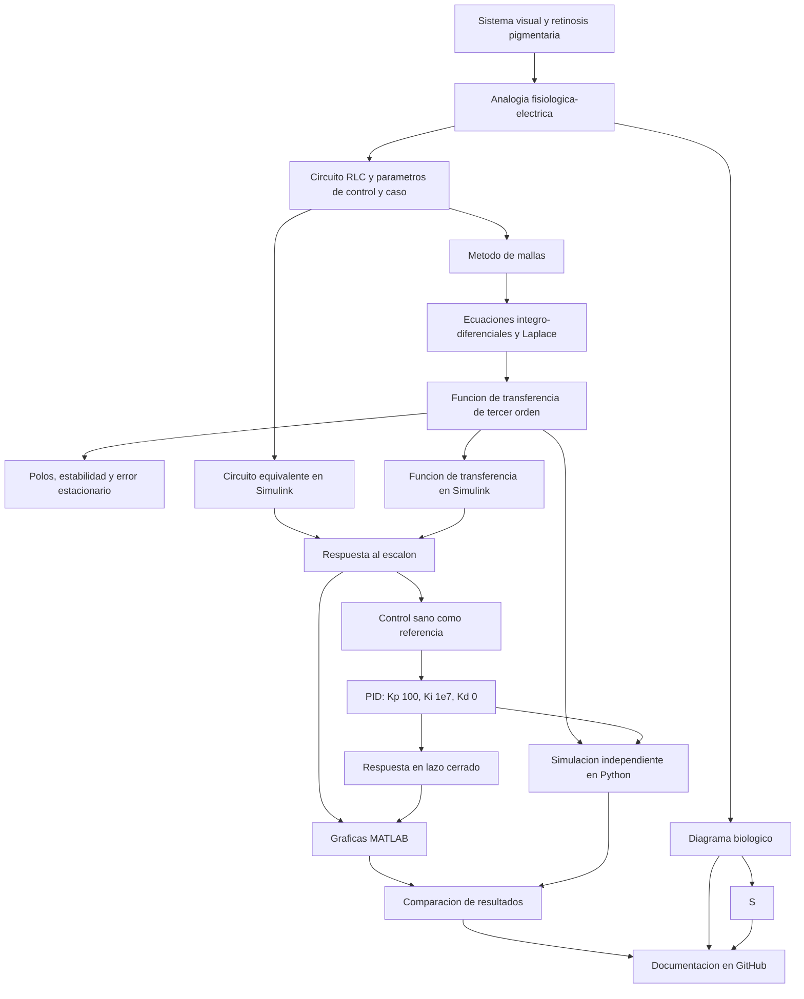
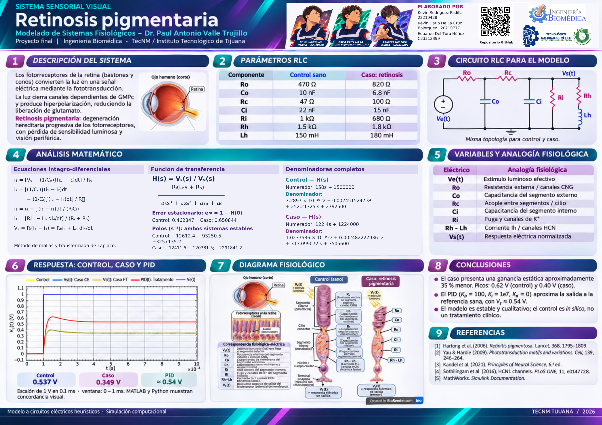

[](https://matlab.mathworks.com/open/github/v1?repo=KevinDarioITT/MSF-ProyectoFinal)

# Proyecto final — Modelado y control de la retinosis pigmentaria en los fotorreceptores

**Docente:** Dr. Paul Antonio Valle Trujillo  
**Correo:** paul.valle@tectijuana.edu.mx  
**Departamento:** Ingeniería Eléctrica y Electrónica  
**Institución:** Tecnológico Nacional de México / Instituto Tecnológico de Tijuana  
**Asignatura:** Modelado de Sistemas Fisiológicos  
**Programa:** Ingeniería Biomédica  
**Sede:** Blvd. Alberto Limón Padilla s/n, C. P. 22454, Tijuana, B. C., México.  
**Repositorio de la asignatura:** https://github.com/DrPaulValle/MSF-IBF1020

### Integrantes

| Estudiante | Número de control | Correo institucional |
|---|---|---|
| De La Cruz Bojorquez Kevin Dario | 20210777 | L20210777@TIJUANA.TECNM.MX |
| Del Toro Nuñez Eduardo | C23212399 | LC23212399@TIJUANA.TECNM.MX |
| Rodriguez Padilla Kevin | 22210428 | L22210428@TIJUANA.TECNM.MX |

**[Consultar el ensayo gráfico del proyecto final (PDF)](Ensayo%20Grafico.pdf)**

Repositorio académico del proyecto final de **Modelado de Sistemas Fisiológicos**. Se estudia la respuesta eléctrica de un fotorreceptor mediante un circuito RLC de tercer orden y se comparan dos condiciones: un individuo sano (control) y un caso simulado de retinosis pigmentaria. Se implementa un controlador PID para aproximar la respuesta del caso a la referencia sana y se comparan los resultados de Simulink, MATLAB y Python.

---

<a id="contenido"></a>
## Contenido

1. [Resumen](#resumen)
2. [Competencia y objetivos](#objetivos)
3. [Relación con el temario](#temario)
4. [Sistema fisiológico y enfermedad](#fisiologico)
5. [Modelo físico y analogía eléctrica](#analogia)
6. [Parámetros y señal de entrada](#parametros)
7. [Formulación matemática](#modelo)
8. [Implementación en MATLAB, Simulink y Simscape](#matlab)
9. [Control en lazo cerrado y sintonización PID](#pid)
10. [Reproducción en Python](#python)
11. [Diagrama biológico](#biologico)
12. [Resultados y verificación cruzada](#resultados)
13. [Discusión y conclusiones](#discusion)
14. [Flujo de trabajo](#flujo)
15. [Actividades del equipo](#actividades)
16. [Estructura del repositorio](#estructura)
17. [Requisitos](#requisitos)
18. [Reproducibilidad y entregables](#reproducibilidad)
19. [Referencias](#referencias)

---

<a id="resumen"></a>
## Resumen

El proyecto tiene como propósito **modelar, analizar, simular y controlar in silico** la respuesta eléctrica de los fotorreceptores de la retina ante un estímulo luminoso sostenido. Se utiliza un circuito compuesto por cuatro resistencias ($R_o$, $R_c$, $R_i$, $R_h$), dos capacitores ($C_o$, $C_i$) y un inductor ($L_h$). Se establecen dos conjuntos de parámetros con la misma topología para representar cualitativamente un individuo sano y un caso de retinosis pigmentaria.

Mediante las leyes de Kirchhoff, el método de mallas y la transformada de Laplace se obtiene una función de transferencia de tercer orden. El análisis de polos indica estabilidad en ambos escenarios. Para una entrada escalón unitario, las ganancias estáticas son aproximadamente $0.5372$ y $0.3492$, respectivamente. La principal diferencia observada es la disminución de amplitud en el caso.

Posteriormente se aplica una estrategia de retroalimentación negativa con un controlador PID de ganancias $k_P=100$, $k_I=10^7$ y $k_D=0$, que funciona como PI. La respuesta sana se utiliza como referencia. Las gráficas de MATLAB y Python muestran que la respuesta controlada se aproxima a la del individuo sano, con una meseta cercana a $0.54$ V, en comparación con $0.35$ V del caso sin controlador.

El proyecto es un modelo **cualitativo y didáctico**: los parámetros eléctricos son heurísticos y no corresponden a mediciones clínicas. El controlador no constituye un tratamiento real para la retinosis pigmentaria.

**Palabras clave:** retinosis pigmentaria; fotorreceptores; fototransducción; circuito RLC; función de transferencia; controlador PID; MATLAB; Simulink; Simscape Electrical; Python.

[Volver al contenido](#contenido)

---

<a id="objetivos"></a>
## Competencia y objetivos

### Competencia a desarrollar

Modelar sistemas fisiológicos mediante analogías eléctricas, ecuaciones integro-diferenciales y funciones de transferencia, analizar su estabilidad y diseñar estrategias de control clásico mediante simulación computacional.

### Objetivo general

Modelar y controlar cualitativamente la respuesta eléctrica de un fotorreceptor sano y de un caso simulado de retinosis pigmentaria mediante un circuito RLC, utilizando MATLAB, Simulink y Python para analizar el comportamiento dinámico y el efecto de un controlador PID.

### Objetivos específicos

- Describir la fototransducción y las alteraciones asociadas con la retinosis pigmentaria.
- Relacionar los componentes del circuito con las estructuras y propiedades eléctricas de un fotorreceptor.
- Establecer los parámetros de control y caso, conservando la topología del circuito.
- Obtener las ecuaciones integro-diferenciales mediante el método de mallas y la función de transferencia mediante Laplace.
- Calcular las ganancias estáticas, el error en estado estacionario y los polos del sistema.
- Comparar el circuito equivalente y la función de transferencia en Simulink.
- Implementar un controlador PID con retroalimentación negativa y utilizar la respuesta sana como referencia.
- Reproducir las respuestas en MATLAB y Python, y comparar las gráficas obtenidas.
- Documentar el desarrollo matemático, las simulaciones y las evidencias en GitHub.

[Volver al contenido](#contenido)

---

<a id="temario"></a>
## Relación con el temario

| Unidad | Área | Contenidos aplicados |
|---|---|---|
| I | Sistemas de control retroalimentados | Señal de referencia, error, retroalimentación negativa, respuesta temporal y estabilidad |
| II | Modelado matemático | Analogía fisiológica-eléctrica, leyes de Kirchhoff, ecuaciones integro-diferenciales y transformada de Laplace |
| III | Controladores | Control PID, acción proporcional e integral y respuesta en lazo cerrado |

El proyecto integra conceptos de fisiología visual, circuitos eléctricos, ingeniería de control y simulación numérica.

[Volver al contenido](#contenido)

---

<a id="fisiologico"></a>
## Sistema fisiológico y enfermedad

### Funcionamiento normal de los fotorreceptores

Los bastones y conos de la retina convierten los estímulos luminosos en señales eléctricas. En oscuridad, los canales activados por GMPc (CNG) del segmento externo permanecen abiertos y permiten la corriente oscura, manteniendo al fotorreceptor relativamente despolarizado. La absorción de luz activa la cascada de fototransducción, disminuye la concentración de GMPc y provoca el cierre de dichos canales, la hiperpolarización de la membrana y la disminución de la liberación de glutamato [1, 2].

El segmento interno contiene estructuras metabólicas y canales iónicos que contribuyen a la respuesta eléctrica, entre ellos los canales de potasio y los canales HCN, asociados con la corriente $I_h$. El cilio conector comunica los segmentos interno y externo.

### Retinosis pigmentaria

La retinosis pigmentaria comprende un grupo de distrofias hereditarias de la retina. En las formas típicas se presenta degeneración progresiva de los bastones y posteriormente de los conos, con dificultades de visión nocturna, pérdida del campo visual periférico y, en etapas avanzadas, deterioro de la visión central [3].

El modelo representa de manera simplificada la disminución de la respuesta eléctrica asociada con la enfermedad. No reproduce la degeneración celular, la diversidad genética ni la evolución clínica. Tampoco debe identificarse el voltaje del circuito con la amplitud real de un electrorretinograma.

[Volver al contenido](#contenido)

---

<a id="analogia"></a>
## Modelo físico y analogía eléctrica

### Topología del circuito

La fuente de entrada $V_e(t)$ se conecta en serie con $R_o$. En el primer nodo se encuentra $C_o$ conectado a tierra. La resistencia $R_c$ conecta ese nodo con el nodo de salida, en el que se encuentran tres ramas en paralelo: $C_i$, $R_i$ y la combinación serie $R_h$–$L_h$.

```text
             Ro             Rc
      +----/\/\/---o------/\/\/-----o------o------o Vs(t)
      |            |                |      |      |
    Ve(t)         Co               Ci     Ri     Rh
      |            |                |      |      |
      |            |                |      |      Lh
      |            |                |      |      |
      +------------+----------------+------+------+ GND
```

El circuito original y sus cuatro corrientes de malla se presentan en la primera página del [análisis matemático](Analisis%20Matema%CC%81tico%20Completo%20%281%29.pdf).

### Correspondencia fisiológica-eléctrica

| Componente | Función eléctrica | Interpretación fisiológica |
|---|---|---|
| $V_e(t)$ | Fuente de voltaje de entrada | Estímulo luminoso efectivo, representado de forma normalizada |
| $R_o$ | Resistencia en serie | Resistencia efectiva del segmento externo, asociada con canales CNG |
| $C_o$ | Capacitancia del primer nodo | Capacitancia de membrana del segmento externo |
| $R_c$ | Resistencia de acoplamiento | Acoplamiento entre los segmentos externo e interno, asociado con el cilio conector |
| $C_i$ | Capacitancia del nodo de salida | Capacitancia de membrana del segmento interno |
| $R_i$ | Resistencia de fuga | Conductancia de fuga y canales de potasio del segmento interno |
| $R_h$ | Resistencia de la rama lenta | Componente resistiva de la aproximación de la corriente $I_h$ |
| $L_h$ | Inductancia de la rama lenta | Aproximación fenomenológica de la dinámica de canales HCN |
| $V_s(t)$ | Voltaje de salida | Respuesta eléctrica normalizada del fotorreceptor |
| Tierra | Referencia eléctrica | Medio extracelular como referencia conceptual |

La capacitancia representa la propiedad de almacenamiento de carga de la membrana. La rama $R_h$–$L_h$ representa una dinámica lenta dependiente del voltaje; no implica que exista una bobina física en el fotorreceptor [4, 5]. La fuente de voltaje y el signo positivo de la respuesta son convenciones didácticas; la respuesta luminosa real corresponde a una hiperpolarización.

[Volver al contenido](#contenido)

---

<a id="parametros"></a>
## Parámetros y señal de entrada

### Conjuntos de parámetros

| Parámetro | Control (sano) | Caso (retinosis pigmentaria) | Interpretación del cambio |
|---|---:|---:|---|
| $R_o$ | $470\ \Omega$ | $820\ \Omega$ | Mayor resistencia efectiva del segmento externo |
| $C_o$ | $10\ \mathrm{nF}$ | $6.8\ \mathrm{nF}$ | Menor capacitancia, asociada cualitativamente con menor área de membrana |
| $R_c$ | $47\ \Omega$ | $100\ \Omega$ | Modificación del acoplamiento entre segmentos |
| $C_i$ | $22\ \mathrm{nF}$ | $15\ \mathrm{nF}$ | Disminución de la capacitancia del segmento interno |
| $R_i$ | $1\ \mathrm{k}\Omega$ | $680\ \Omega$ | Mayor conductancia de fuga |
| $R_h$ | $1.5\ \mathrm{k}\Omega$ | $1.8\ \mathrm{k}\Omega$ | Ajuste heurístico de la rama lenta |
| $L_h$ | $150\ \mathrm{mH}$ | $180\ \mathrm{mH}$ | Ajuste heurístico de la dinámica lenta |

Los siete parámetros cambian entre las condiciones. Los valores se eligieron para obtener un comportamiento diferenciado y no constituyen parámetros clínicamente validados. En particular, los cambios en $R_h$ y $L_h$ mantienen la relación $L_h/R_h=100\ \mu\mathrm{s}$ en ambas condiciones.

### Señal de entrada

Se selecciona un escalón unitario para representar un cambio sostenido de iluminación:

$$
V_e(t)=A\,u(t-t_0),\qquad A=1\ \mathrm{V},\quad t_0=10^{-4}\ \mathrm{s}.
$$

La ventana de análisis de las gráficas es de $0$ a $10^{-3}$ s (1 ms). Se eligió el escalón porque permite observar el transitorio, la ganancia estática y el establecimiento de la respuesta. No permite estudiar la recuperación al retirar el estímulo.

El cuaderno MATLAB conserva el título «Respuesta al impulso», pero la señal efectivamente representada en las gráficas y programada en Python es un **escalón**, no un impulso de Dirac.

[Volver al contenido](#contenido)

---

<a id="modelo"></a>
## Formulación matemática

El desarrollo manuscrito se encuentra en [Análisis Matemático Completo](Analisis%20Matema%CC%81tico%20Completo%20%281%29.pdf). Se consideran condiciones iniciales nulas y cuatro corrientes de malla $i_1(t)$, $i_2(t)$, $i_3(t)$ e $i_4(t)$.

### 1. Ecuaciones integro-diferenciales

**Malla 1**

$$
V_e(t)=R_o i_1(t)+\frac{1}{C_o}\int_0^t[i_1(\tau)-i_2(\tau)]\,d\tau
$$

**Malla 2**

$$
0=R_c i_2(t)+\frac{1}{C_i}\int_0^t[i_2(\tau)-i_3(\tau)]\,d\tau+\frac{1}{C_o}\int_0^t[i_2(\tau)-i_1(\tau)]\,d\tau
$$

**Malla 3**

$$
0=\frac{1}{C_i}\int_0^t[i_3(\tau)-i_2(\tau)]\,d\tau+R_i[i_3(t)-i_4(t)]
$$

**Malla 4**

$$
0=R_i[i_4(t)-i_3(t)]+R_hi_4(t)+L_h\frac{di_4(t)}{dt}
$$

**Ecuación de salida**

$$
V_s(t)=R_hi_4(t)+L_h\frac{di_4(t)}{dt}=R_i[i_3(t)-i_4(t)]
$$

### 2. Transformada de Laplace

$$
V_e(s)=R_oI_1(s)+\frac{I_1(s)-I_2(s)}{sC_o}
$$

$$
0=R_cI_2(s)+\frac{I_2(s)-I_3(s)}{sC_i}+\frac{I_2(s)-I_1(s)}{sC_o}
$$

$$
0=\frac{I_3(s)-I_2(s)}{sC_i}+R_i[I_3(s)-I_4(s)]
$$

$$
0=R_i[I_4(s)-I_3(s)]+(R_h+sL_h)I_4(s)
$$

$$
V_s(s)=(R_h+sL_h)I_4(s)
$$

Despejando sucesivamente las corrientes en términos de $I_4(s)$:

$$
I_3(s)=\frac{R_i+R_h+sL_h}{R_i}I_4(s)
$$

$$
I_2(s)=(1+sC_iR_i)I_3(s)-sC_iR_iI_4(s)
$$

$$
I_1(s)=\left(1+sC_oR_c+\frac{C_o}{C_i}\right)I_2(s)-\frac{C_o}{C_i}I_3(s)
$$

### 3. Función de transferencia

Al sustituir las expresiones anteriores en la ecuación de entrada y utilizar la ecuación de salida se obtiene:

$$
H(s)=\frac{V_s(s)}{V_e(s)}=\frac{R_iL_hs+R_iR_h}{a_3s^3+a_2s^2+a_1s+a_0}
$$

Los coeficientes del denominador, agrupados algebraicamente, son:

$$
a_3=C_oC_iR_oR_cR_iL_h
$$

$$
a_2=R_oC_oR_iL_h+(R_o+R_c)C_iR_iL_h+R_oR_cC_o(L_h+C_iR_iR_h)
$$

$$
a_1=R_iL_h+R_oC_oR_iR_h+(R_o+R_c)(L_h+C_iR_iR_h)+R_oR_cC_o(R_i+R_h)
$$

$$
a_0=R_iR_h+(R_o+R_c)(R_i+R_h)
$$

El circuito contiene tres elementos independientes de almacenamiento de energía: $C_o$, $C_i$ y $L_h$. Por ello, la función de transferencia es de **tercer orden y estrictamente propia**.

### 4. Funciones de transferencia de control y caso

**Control:**

$$
H_{Control}(s)=\frac{150s+1500000}{7.2897\times10^{-10}s^3+0.0024515247s^2+252.21325s+2792500}
$$

**Caso:**

$$
H_{Caso}(s)=\frac{122.4s+1224000}{1.0237536\times10^{-9}s^3+0.002482227936s^2+313.099072s+3505600}
$$

Coeficientes utilizados en los bloques de función de transferencia y en Python:

| Condición | Numerador | Denominador |
|---|---|---|
| Control | `[150, 1500000]` | `[7.2897e-10, 0.0024515247, 252.21325, 2792500]` |
| Caso | `[122.4, 1224000]` | `[1.0237536e-9, 0.002482227936, 313.099072, 3505600]` |

### 5. Ganancia estática y error en estado estacionario

Para una entrada escalón unitario y un sistema estable, el teorema del valor final proporciona:

$$
V_s(\infty)=\lim_{s\to0}sH(s)\frac{1}{s}=H(0)=\frac{R_iR_h}{R_oR_h+R_oR_i+R_cR_h+R_cR_i+R_iR_h}
$$

Tomando como referencia la entrada unitaria:

$$
e_{ss}=\lim_{s\to0}s\left[\frac{1-H(s)}{s}\right]=1-H(0)
$$

| Condición | Ganancia estática | Error respecto a la entrada unitaria |
|---|---:|---:|
| Control | $0.537153$ | $0.462847$ |
| Caso | $0.349156$ | $0.650844$ |

La diferencia estacionaria entre las respuestas sana y patológica es $0.187997$ V. Este error de seguimiento entre ambas salidas es distinto del error respecto a la entrada unitaria.

### 6. Polos y estabilidad

Los polos se obtienen mediante `np.roots` a partir de los denominadores de las funciones de transferencia:

| Polo ($\mathrm{s}^{-1}$) | Control | Caso |
|---|---:|---:|
| $p_1$ | $-12612.3663$ | $-12411.4569$ |
| $p_2$ | $-93250.4990$ | $-120381.4658$ |
| $p_3$ | $-3257135.2005$ | $-2291841.2236$ |

Los tres polos de cada sistema son reales y negativos, ubicados en el semiplano izquierdo. Por lo tanto, el control y el caso son estables en lazo abierto. Los polos dominantes corresponden a constantes de tiempo aproximadas de $79.3\ \mu\mathrm{s}$ y $80.6\ \mu\mathrm{s}$, respectivamente.

Los valores de error y polos de esta sección se calcularon nuevamente a partir de los coeficientes definitivos del código de Python para evitar inconsistencias de rotulación del desarrollo manuscrito.

[Volver al contenido](#contenido)

---

<a id="matlab"></a>
## Implementación en MATLAB, Simulink y Simscape

### Representaciones del sistema

El modelo [`ProyectoFinal.slx`](ProyectoFinal.slx) contiene dos subsistemas principales: `Vs(t): Control` y `Vs(t): Caso`. La inspección de los bloques del archivo fuente confirma la siguiente distribución:

| Representación | Control | Caso |
|---|:---:|:---:|
| Ecuaciones integro-diferenciales (EID), cuatro mallas | Sí | No implementado |
| Circuito equivalente (CE), Simscape | Sí | Sí |
| Función de transferencia (FT), Simulink | Sí | Sí |
| Control en lazo cerrado con PI | Referencia | Sí |

El subsistema `Vs(t): EID Control` contiene `Malla1`, `Malla2`, `Malla3` y `Malla4`, implementadas mediante sumadores, ganancias e integradores. La salida se obtiene como $V_s(t)=R_i[i_3(t)-i_4(t)]$. Los circuitos equivalentes contienen los siete componentes RLC, una fuente de voltaje controlada, un sensor de voltaje, referencia eléctrica, convertidores y el bloque *Solver Configuration*. Se verificó que los valores de los componentes y los coeficientes de FT coinciden con las tablas de este README.

El modelo contiene dos osciloscopios: `Test: Control`, que compara CE, FT y EID del control, y `Test: Caso`, que compara control FT, caso CE, caso FT, tratamiento PID y estímulo. La captura disponible del [Scope de Simulink](ScopeProyectoFinal.pdf) corresponde al segundo. Las curvas CE y FT del caso prácticamente coinciden en la resolución de la captura. La salida de FT del control es la referencia del lazo de retroalimentación y la señal `Fs1` exportada; la señal `FsC` proviene de FT del caso.

### Cuaderno de MATLAB

El cuaderno [`Proyecto_Final_MATLAB.mlx`](Proyecto_Final_MATLAB.mlx) ejecuta el modelo `ProyectoFinal.slx`, exporta las señales y genera la figura con `plotsignals`. También está disponible su [exportación en PDF](Proyecto%20Final%20MatLab%20%281%29.pdf).

```matlab
clc; clear; close all; warning('off','all')
open_system('ProyectoFinal.slx')
parameters.StopTime = '10';
parameters.Solver = 'ode15s';
parameters.MaxStep = '1e-3';
x = sim('ProyectoFinal.slx', parameters);
datos = table(x.tout(:),x.F(:),x.Fs1(:),x.FsC(:),x.PID(:), ...
    'VariableNames',{'t','F','Fs1','FsC','PID'});
writetable(datos,'ProyectoFinal.csv');
plotsignals(x.tout,x.F,x.Fs1,x.FsC,x.PID)
```

| Variable | Contenido |
|---|---|
| `x.tout` | Tiempo de simulación |
| `x.F` | Estímulo de entrada $V_e(t)$ |
| `x.Fs1` | Respuesta del control |
| `x.FsC` | Respuesta del caso |
| `x.PID` | Respuesta del caso con controlador |

La función `plotsignals` utiliza cuatro colores y una leyenda en LaTeX. Configura el eje temporal de $0$ a $10^{-3}$ s y exporta la figura como `Control_caso_matlab.pdf`.

### Configuración de simulación verificada

| Ajuste | Modelo `.slx` guardado | Cuaderno `.mlx` |
|---|---|---|
| Tiempo inicial | `0.0` s | Se conserva el ajuste del modelo |
| Tiempo final | `1e-3` s | `10` s |
| Solver | Selección automática (`VariableStepAuto`) | `ode15s` |
| Paso máximo | `auto` | `1e-3` s |
| Ventana de la gráfica | 0–1 ms | 0–1 ms |

El bloque `Step` tiene tiempo de activación `1e-4` s. El cuaderno utiliza parámetros de simulación distintos a los guardados en el modelo; la figura solo presenta el primer milisegundo. Para repetir una simulación limitada a la ventana de interés, puede ajustarse `parameters.StopTime = '1e-3'` antes de ejecutar. El paso máximo no equivale al paso efectivo del integrador.

El cuaderno original escribe el CSV en `C:\Users\kevin\Desktop\ProyectoFinal.csv`. El fragmento anterior propone reemplazar esa ruta absoluta por `writetable(datos,'ProyectoFinal.csv');` para guardar el archivo en la carpeta de trabajo y facilitar la ejecución en otros equipos. Esta modificación de portabilidad no altera las ecuaciones ni las ganancias y no se ha aplicado al archivo fuente original.

Los metadatos indican que el `.slx` fue guardado con MATLAB R2023a y el `.mlx` con R2025b. La configuración interna se verificó leyendo ambos archivos; no se ejecutó MATLAB/Simulink para comprobar la corrida.

[Volver al contenido](#contenido)

---

<a id="pid"></a>
## Control en lazo cerrado y sintonización PID

### 1. Esquema de control

La salida del individuo sano se utiliza como referencia para el caso. La diferencia entre esta referencia y la salida controlada constituye la señal de error:

$$
e(t)=V_{s,Control}(t)-V_{s,PID}(t)
$$

La ley de control PID es:

$$
u_c(t)=k_Pe(t)+k_I\int_0^t e(\tau)\,d\tau+k_D\frac{de(t)}{dt}
$$


### 2. Ganancias del controlador

Los parámetros se documentan en [Parametros de Controlador](Parametros%20de%20Controlador.pdf) y se verificaron directamente en el bloque `PID Controller` del subsistema `Vs(t): Caso`; coinciden con el código de Python. El sumador recibe la referencia sana en la entrada positiva y la salida controlada en la negativa, y el PI actúa sobre una segunda instancia de la FT del caso.

| Parámetro | Valor |
|---|---:|
| Proporcional $k_P$ | $100$ |
| Integral $k_I$ | $10^7$ |
| Derivativo $k_D$ | $0$ |
| Coeficiente del filtro $N$ | $100$ |
| Forma | Paralela |
| Dominio | Tiempo continuo |

El bloque se encuentra configurado como PID, aunque al ser $k_D=0$ funciona como un controlador **PI**. El filtro derivativo no contribuye a la respuesta con dicha ganancia nula. La evidencia muestra la configuración final, no el procedimiento de selección de las ganancias.

$$
K(s)=100+\frac{10^7}{s}=\frac{100s+10^7}{s}
$$

### 3. Función de transferencia en lazo cerrado

Con retroalimentación unitaria negativa:

$$
T(s)=\frac{K(s)H_{Caso}(s)}{1+K(s)H_{Caso}(s)}
$$

La respuesta completa respecto al estímulo original incluye el modelo sano como referencia:

$$
\frac{V_{s,PID}(s)}{V_e(s)}=H_{Control}(s)\,T(s)
$$

Sustituyendo los coeficientes del caso y las ganancias del PI:

$$
T(s)=\frac{12240s^2+1346400000s+1.224\times10^{13}}{1.0237536\times10^{-9}s^4+0.002482227936s^3+12553.099072s^2+1349905600s+1.224\times10^{13}}
$$

El cálculo adicional de las raíces del denominador de $T(s)$ da aproximadamente:

$$
p_{1,2}=-1.1575\times10^6\pm j\,3.2661\times10^6,\qquad p_3=-99631.13,\qquad p_4=-9994.35
$$

Todos tienen parte real negativa, por lo que el lazo cerrado es estable. Los polos del modelo de referencia también son negativos. Además, $T(0)=1$, de modo que el error estacionario respecto a la referencia sana tiende a cero en el modelo ideal, aunque no respecto a la entrada unitaria.

[Volver al contenido](#contenido)

---

<a id="python"></a>
## Reproducción en Python

El archivo [`Proyecto_Final.py`](Proyecto_Final.py) reproduce las respuestas mediante las funciones de transferencia y las bibliotecas `numpy`, `control` y `matplotlib`. A diferencia de la graficación en MATLAB, el script calcula sus propias respuestas sin depender de un archivo CSV exportado por Simulink.

### Datos de la simulación

| Parámetro | Valor |
|---|---:|
| Tiempo inicial | $0$ s |
| Tiempo final | $10^{-3}$ s |
| Paso temporal | $10^{-8}$ s |
| Inicio del escalón | $10^{-4}$ s |
| Amplitud | $1$ V |
| Condición inicial | $0$ |
| Número de muestras | $100001$ |

### Implementación del controlador

```python
kP,kI,kD = 100,1E7,0
numPID = [kD,kP,kI]
denPID = [1,0]
PID = ctrl.tf(numPID,denPID)

sysPID = ctrl.feedback(ctrl.series(PID,sysCaso),1,sign=-1)
sysPID = ctrl.series(sysControl,sysPID)
```

Las funciones `openloop` y `closedloop` utilizan `ctrl.forced_response` para calcular la respuesta temporal. La función `plotsignals` compara el estímulo, el control, el caso y el caso con controlador y guarda `Control_caso_python.pdf`.

**Instalación de dependencias:**

```bash
pip install numpy control matplotlib
```

**Ejecución:**

```bash
python Proyecto_Final.py
```

[Volver al contenido](#contenido)

---

<a id="biologico"></a>
## Diagrama biológico



*Figura 1. Diagrama elaborado en BioRender. Se compara un fotorreceptor sano con uno afectado por retinosis pigmentaria y se identifican las correspondencias fisiológicas de los elementos del circuito equivalente.*

El diagrama ubica la retina en el ojo humano, los bastones, el segmento externo, el cilio conector, el segmento interno y la terminal sináptica. Los componentes $R_o$ y $C_o$ se asocian con el segmento externo, $R_c$ con el acoplamiento entre segmentos y $C_i$, $R_i$ y $R_h$–$L_h$ con propiedades eléctricas del segmento interno. La señal $V_e(t)$ representa el estímulo luminoso y $V_s(t)$ la respuesta normalizada.

[Volver al contenido](#contenido)

---

<a id="resultados"></a>
## Resultados y verificación cruzada

### 1. Respuesta en lazo abierto

El estímulo permanece en cero hasta $t=0.1$ ms y posteriormente alcanza 1 V. El control presenta un pico cercano a $0.62$ V y una meseta de $0.54$ V. El caso presenta un pico cercano a $0.40$ V y una meseta de $0.35$ V.

| Magnitud | Control | Caso |
|---|---:|---:|
| Pico del transitorio (lectura gráfica aproximada) | $0.62$ V | $0.40$ V |
| Meseta (lectura gráfica aproximada) | $0.54$ V | $0.35$ V |
| Valor final analítico | $0.537153$ V | $0.349156$ V |

La ganancia estacionaria del caso es aproximadamente 35 % menor que la del control. Ambas respuestas presentan un pico transitorio y un descenso hacia la meseta, sin oscilaciones sostenidas visibles.

### 2. Respuesta en lazo cerrado

En las gráficas de MATLAB y Python, la salida del caso con controlador se superpone aproximadamente a la respuesta de referencia. El tratamiento simulado presenta un pico cercano a $0.62$ V y una meseta cercana a $0.54$ V. La diferencia estacionaria respecto al control se reduce desde aproximadamente $0.188$ V (lazo abierto) hasta cero en el modelo analítico ideal.

Este resultado representa seguimiento de una referencia eléctrica; no demuestra recuperación del tejido retiniano ni eficacia terapéutica.

### 3. Verificación cruzada entre plataformas

| Evidencia | Control | Caso | Caso con PID |
|---|---|---|---|
| Scope de Simulink | Incluido en la leyenda; no se distingue por separado en la captura | CE y FT prácticamente superpuestos | Meseta cercana a $0.54$ V |
| MATLAB | Meseta cercana a $0.54$ V | Meseta cercana a $0.35$ V | Aproximadamente superpuesto al control |
| Python | Meseta cercana a $0.54$ V | Meseta cercana a $0.35$ V | Aproximadamente superpuesto al control |

La inspección del modelo confirma la implementación EID, CE y FT del control, y CE y FT del caso. No se dispone de una captura de `Test: Control` que permita comprobar visualmente la superposición de las tres representaciones sanas. Las evidencias presentan concordancia visual en el comportamiento del caso y la respuesta controlada. MATLAB y Python muestran también concordancia visual de la referencia sana. No se reporta un RMSE ni un tiempo de establecimiento exacto entre plataformas porque no se dispone de las series numéricas de Simulink para realizar esa comparación.

### 4. Archivos de resultados

| Evidencia | Archivo |
|---|---|
| Scope de Simulink | [ScopeProyectoFinal.pdf](ScopeProyectoFinal.pdf) |
| Configuración del PID | [Parametros de Controlador.pdf](Parametros%20de%20Controlador.pdf) |
| Respuestas en MATLAB | [grafica de matlab](grafica%20de%20matlab%20%281%29.pdf) |
| Respuestas en Python | [grafica de python](grafica%20de%20python%20%281%29.pdf) |
| Cuaderno MATLAB exportado | [Proyecto Final MatLab](Proyecto%20Final%20MatLab%20%281%29.pdf) |
| Análisis matemático | [Análisis Matemático Completo](Analisis%20Matema%CC%81tico%20Completo%20%281%29.pdf) |
| Ensayo gráfico del proyecto final | [Ensayo Grafico.pdf](Ensayo%20Grafico.pdf) |

[Volver al contenido](#contenido)

---

<a id="discusion"></a>
## Discusión y conclusiones

### Discusión

**Comportamiento del modelo.** La modificación de los parámetros eléctricos reduce la ganancia del caso respecto al control. La reducción de capacitancia y los cambios de resistencia representan cualitativamente alteraciones en el área de membrana, la conductancia y el acoplamiento entre segmentos. Como todos los parámetros cambian simultáneamente, no se atribuye la reducción a un único componente.

**Estabilidad.** Los polos de las plantas son reales y negativos. Los polos dominantes son cercanos entre ambas condiciones, por lo que el modelo representa principalmente una diferencia de amplitud y no una diferencia marcada en el tiempo de respuesta.

**Control en lazo cerrado.** El PI permite que la respuesta del caso se aproxime a la del control. La acción integral elimina el error estacionario respecto a la referencia constante en el modelo matemático estable. La comparación de las gráficas permite observar esta aproximación.

**Limitaciones.** El circuito es lineal e invariante en el tiempo, utiliza parámetros heurísticos y no describe la cascada completa de fototransducción, la adaptación a la luz, la variación entre bastones y conos ni la muerte celular progresiva. La inductancia constituye una aproximación fenomenológica. La escala temporal simulada es considerablemente más rápida que la respuesta de un fotorreceptor real. No existen datos experimentales que validen los parámetros o el controlador.

### Conclusiones

- Se obtuvo una función de transferencia de tercer orden a partir del circuito RLC utilizando las leyes de Kirchhoff y la transformada de Laplace.
- El análisis de polos confirmó que el control y el caso son estables en lazo abierto.
- La respuesta del caso presenta una reducción de aproximadamente 35 % en la ganancia estática respecto al individuo sano.
- El controlador con ganancias $k_P=100$, $k_I=10^7$ y $k_D=0$ permite aproximar la salida del caso a la referencia sana, con una respuesta estable en lazo cerrado.
- Las gráficas disponibles de Simulink, MATLAB y Python presentan concordancia visual en las respuestas comparables.
- El proyecto demuestra una estrategia de modelado y control in silico con fines académicos, sin constituir un tratamiento clínico para la retinosis pigmentaria.

[Volver al contenido](#contenido)

---

<a id="flujo"></a>
## Flujo de trabajo



[Volver al contenido](#contenido)

---

<a id="actividades"></a>
## Actividades del equipo

Lista basada en las evidencias documentales disponibles, no en una rúbrica oficial del proyecto:

- [x] Selección del sistema fisiológico y la enfermedad.
- [x] Elaboración de la analogía fisiológica-eléctrica.
- [x] Definición de los parámetros de control y caso.
- [x] Desarrollo de ecuaciones integro-diferenciales y función de transferencia.
- [x] Cálculo de polos, estabilidad y error estacionario.
- [x] Obtención de la captura de las respuestas CE y FT en Simulink.
- [x] Configuración del controlador PID y registro de sus ganancias.
- [x] Desarrollo del cuaderno MATLAB y exportación de resultados.
- [x] Desarrollo del código de Python y exportación de resultados.
- [x] Elaboración del diagrama biológico en BioRender.
- [x] Comparación visual de las gráficas disponibles.
- [x] Inspección de los archivos fuente de Simulink y MATLAB.
- [x] Elaboración del ensayo gráfico del proyecto final.

[Volver al contenido](#contenido)

---

<a id="estructura"></a>
## Estructura del repositorio

Organización propuesta con los archivos fuente y las evidencias recibidas. Se supone que los archivos se colocan junto al README; si se utilizan subcarpetas, deben actualizarse las rutas de los enlaces. Para que la llamada del cuaderno funcione, subir `ProyectoFinal(3).slx` con el nombre `ProyectoFinal.slx`. Se propone subir `Proyecto_Final_MATLAB (1).mlx` como `Proyecto_Final_MATLAB.mlx`. Los demás nombres se conservan según los enlaces de este documento. La estructura efectiva de GitHub todavía no se ha confirmado.

```text
.
├── README.md
├── Ensayo Grafico.pdf
├── Ensayo_Grafico.png
├── Biorender.png
├── Proyecto_Final.py
├── Proyecto Final MatLab (1).pdf
├── Analisis Matemático Completo (1).pdf
├── ScopeProyectoFinal.pdf
├── Parametros de Controlador.pdf
├── grafica de matlab (1).pdf
├── grafica de python (1).pdf
├── ProyectoFinal.slx                  
└── Proyecto_Final_MATLAB.mlx          
```

[Volver al contenido](#contenido)

---

<a id="requisitos"></a>
## Requisitos

- MATLAB y Simulink para ejecutar el modelo y el cuaderno computacional (se recomienda R2025b por la versión de guardado del cuaderno).
- Simscape Electrical para reproducir el circuito equivalente físico.
- Python 3 con `numpy`, `control` y `matplotlib`.
- GitHub para consultar el repositorio y sus evidencias.
- BioRender para editar el diagrama biológico, si se dispone del archivo original.

[Volver al contenido](#contenido)

---

<a id="reproducibilidad"></a>
## Reproducibilidad y entregables

### Secuencia de reproducción

1. Descargar o clonar el repositorio.
2. Colocar `ProyectoFinal.slx` y `Proyecto_Final_MATLAB.mlx` en la misma carpeta de trabajo de MATLAB y abrir el modelo.
3. Verificar los parámetros de control y caso, el escalón unitario en $t=10^{-4}$ s y las ganancias del controlador.
4. Abrir `Proyecto_Final_MATLAB.mlx`, verificar los ajustes del solver y la ventana temporal, y reemplazar la ruta absoluta de `writetable` por `writetable(datos,'ProyectoFinal.csv');` si se requiere. Ejecutar el cuaderno para obtener las gráficas.
5. Instalar las bibliotecas de Python y ejecutar `Proyecto_Final.py`.
6. Comparar las respuestas obtenidas con los PDF de evidencia.

### Entregables

| Entregable | Evidencia |
|---|---|
| Diagrama fisiológico | [`Biorender.png`](Biorender.png) |
| Ecuaciones, función de transferencia y polos | [Análisis Matemático Completo](Analisis%20Matema%CC%81tico%20Completo%20%281%29.pdf) |
| Modelo Simulink | [`ProyectoFinal.slx`](ProyectoFinal.slx) |
| Respuestas CE y FT | [Scope de Simulink](ScopeProyectoFinal.pdf) |
| Configuración del controlador | [Parametros de Controlador](Parametros%20de%20Controlador.pdf) |
| Cuaderno MATLAB | [`Proyecto_Final_MATLAB.mlx`](Proyecto_Final_MATLAB.mlx) y [exportación en PDF](Proyecto%20Final%20MatLab%20%281%29.pdf) |
| Código Python | [`Proyecto_Final.py`](Proyecto_Final.py) |
| Resultados gráficos | [MATLAB](grafica%20de%20matlab%20%281%29.pdf) y [Python](grafica%20de%20python%20%281%29.pdf) |
| Ensayo gráfico | [Ensayo Grafico.pdf](Ensayo%20Grafico.pdf) |
| Documentación | `README.md` |

[Volver al contenido](#contenido)

---

<a id="referencias"></a>
## Referencias

[1] Kandel, E. R., Koester, J. D., Mack, S. H., & Siegelbaum, S. A. (Eds.). (2021). *Principles of neural science* (6th ed.). McGraw-Hill.

[2] Yau, K.-W., & Hardie, R. C. (2009). Phototransduction motifs and variations. *Cell, 139*(2), 246–264. https://doi.org/10.1016/j.cell.2009.09.029

[3] Hartong, D. T., Berson, E. L., & Dryja, T. P. (2006). Retinitis pigmentosa. *The Lancet, 368*(9549), 1795–1809. https://doi.org/10.1016/S0140-6736(06)69740-7

[4] Mauro, A., Conti, F., Dodge, F., & Schor, R. (1970). Subthreshold behavior and phenomenological impedance of the squid giant axon. *The Journal of General Physiology, 55*(4), 497–523. https://doi.org/10.1085/jgp.55.4.497

[5] Sothilingam, V., Michalakis, S., Garcia Garrido, M., Biel, M., Tanimoto, N., & Seeliger, M. W. (2016). HCN1 channels enhance rod system responsivity in the retina under conditions of light exposure. *PLOS ONE, 11*(1), e0147728. https://doi.org/10.1371/journal.pone.0147728

[6] P. A. Valle, *Syllabus para Modelado de Sistemas Fisiológicos*, Tecnológico Nacional de México / Instituto Tecnológico de Tijuana, 2026. https://biomath.xyz/course/

---

<a id="ensayo-grafico"></a>
## Ensayo gráfico

Como complemento de la documentación técnica, se elaboró un ensayo gráfico de una página en formato horizontal que sintetiza el desarrollo del proyecto final. El documento integra la descripción del sistema fisiológico y la retinosis pigmentaria, los parámetros RLC del control y del caso, el circuito equivalente, las ecuaciones integro-diferenciales, las funciones de transferencia con sus denominadores completos, los polos y el error estacionario.

También presenta la analogía fisiológica-eléctrica, las respuestas del control, del caso y del tratamiento simulado con PID, el diagrama fisiológico de BioRender, las conclusiones y las referencias bibliográficas. Incluye un código QR que dirige al repositorio del proyecto.

[](Ensayo%20Grafico.pdf)

*Figura 2. Ensayo gráfico del proyecto final.

**Documento:** [Ensayo Grafico.pdf](Ensayo%20Grafico.pdf)

[Volver al contenido](#contenido)

---

## Uso académico

Este repositorio documenta el proyecto final de la asignatura **Modelado de Sistemas Fisiológicos**, del programa de Ingeniería Biomédica del Tecnológico Nacional de México / Instituto Tecnológico de Tijuana. El trabajo se desarrolla exclusivamente mediante simulación *in silico*. El modelo y el controlador tienen propósitos académicos y no constituyen un dispositivo médico, una intervención terapéutica ni una propuesta de tratamiento clínicamente validada para la retinosis pigmentaria.

[Volver al contenido](#contenido)
